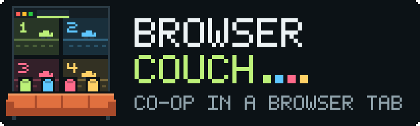

<p align="center"></p>

# Browser Couch

Couch co-op in a browser. Your friends open a link and play: no install, no
account, no setup. They join over a LAN, a tailnet or a VPN; play over the
open internet is possible but not yet tested.

One Linux or Apple Silicon macOS machine runs a PS1 or PS2 game. Friends open its website and
claim separate player slots. Video, audio and controls travel over WebRTC;
if that cannot connect, the client automatically uses a WebSocket stream.

This is a first host prototype. Two browsers have independently controlled
separate players and started a shared two-player game. Four simultaneous
people, physical gamepads and internet conditions have not yet been validated.

## Game night

One host computer runs the game. Players join from a browser on the LAN
or on your tailnet. The tailnet gives HTTPS, so gamepads work there.

### Host checklist

Do these steps before the players arrive.

1. If the host is a laptop, connect it to power. Use wired Ethernet if you can.
2. Run `./setup.sh` once.
3. Make sure that `runtime/system/scph1001.bin` exists. The built-in HLE BIOS
   can freeze a two-player session.
4. Extract the game outside this repository, for example to
   `~/Games/my-game/`. Keep the CUE and all its BIN tracks together.
5. Start the host for the LAN and the tailnet:

   ```sh
   ./run.sh --disc ~/Games/my-game/GAME.cue --host 0.0.0.0 --pin gameNight
   ```

6. If macOS asks "Do you want the application `python3.12` to accept incoming
   network connections?", click **Allow**. If you click **Deny**, LAN players
   cannot connect. The tailnet still works.
7. Add the tailnet entry once. It stays until you remove it:

   ```sh
   tailscale serve --bg --https=443 --set-path /lan/ http://127.0.0.1:8081
   ```

8. Get the LAN address with `ipconfig getifaddr en0`. If that is empty, use
   `en1`.
9. Open http://localhost:8081 on the host. Join as player 1.
10. Give the players the join URL and the room code. The terminal prints the
    room code.
11. Use `tailscale serve`, never `tailscale funnel`. Funnel puts the game on
    the public internet.

To stop, press Ctrl+C. The host saves the memory card in `runtime/saves/`.
If `run.sh` says that port 8081 is in use, an old host still runs. Find it with
`lsof -nP -iTCP:8081 -sTCP:LISTEN`.
To remove the tailnet entry, run `tailscale serve --https=443 --set-path /lan/ off`.
Some tailnet ACLs allow only ports 80 and 443 to a device. A port such
as 8443 then times out for players, so use a path on 443. The trailing slash
in `/lan/` is necessary. The page adds it if a player leaves it out.

### Player instructions

1. Open the join URL:
   - Tailnet (gamepads work): `https://HOST.TAILNET.ts.net/lan/`
   - LAN (keyboard and touch only): `http://LAN-IP:8081`
2. Type your name and the room code. Click **Join the game**.
3. You get the first open player slot. To change, click a different open slot.
4. Click **Enable sound** below the picture.
5. Keep the tab in front. If you change tabs, your controller releases.

Use the left hand to move and the right hand for the buttons.

| Button | Keyboard |
| --- | --- |
| D-pad (PS1) | WASD or arrow keys |
| Left stick (PS2) | WASD |
| Right stick (PS2) | Arrow keys |
| D-pad (PS2) | T F G H |
| Cross | K or Space |
| Square | J |
| Circle | L |
| Triangle | I |
| L1 / R1 | U / O |
| L2 / R2 | Y / P |
| Start | Enter |
| Select | Shift |
| L3 / R3 | C / M |

A standard USB or Bluetooth gamepad works on the tailnet URL. Xbox, PS4 and PS5
controllers use the PlayStation layout: A is Cross, B is Circle, X is Square and
Y is Triangle. Connect the gamepad, then push a button while the tab is in front.
If the page says that it does not know the layout, use Chrome, Edge or Safari. On a phone, use the touch buttons below
the picture. Tap **Fullscreen** to put the buttons over the picture. Tap **✕** to
leave fullscreen.

### LAN on plain HTTP

1. Start the host with `--host 0.0.0.0`. The default port is 8081.
2. Get the host address with `ipconfig getifaddr en0`.
3. Players open `http://LAN-IP:8081`.

Keyboard and touch work on plain HTTP. Gamepads do not, because browsers only
expose gamepads on HTTPS or localhost. WebRTC uses dynamic UDP ports. If the
firewall blocks them, the client uses the WebSocket stream.

Some Wi-Fi networks, such as guest networks, block traffic between devices (client isolation).
If a player cannot open the LAN URL but the host can, the network is the
cause. Then use the tailnet URL.

### Tailnet

`tailscale serve` gives a tailnet-only HTTPS URL with a trusted certificate.
It proxies to `127.0.0.1:8081`. The host trusts `X-Forwarded-Proto` and
`X-Forwarded-For` only from loopback, so joins pass the same-origin check.
WebRTC media goes directly to the host's tailnet IP over UDP. If UDP cannot
connect, the client uses the WebSocket stream over the HTTPS port. That stream
is slower. If the tailnet ACLs block UDP, ask the admins to allow a fixed range
and start the host with it:

```sh
./run.sh --disc ~/Games/my-game/GAME.cue --host 0.0.0.0 --udp-ports 40000-40199
```

Each browser uses one UDP port for each host network address. 200 ports are
enough for 12 browsers.

A player on a shared tailnet can reach the host only if its ACLs allow it.
To test that, do this two-minute test with one player:

1. Start the host and the serve entry. Use the steps in the host checklist.
2. Send the player `https://HOST.TAILNET.ts.net/lan/` and the room code.
3. If the page does not open, the ACLs block TCP 443 to your device. Ask the
   tailnet admins to allow it, or use the LAN.
4. Tell the player to join and click **Enable sound**.
5. Tell the player to open **Connection details** and read the transport.
   "WebRTC" means that UDP works. "Fallback" means that only TCP works. Both
   are playable.
6. Tell the player to push the D-pad. Make sure that their slot moves on
   your screen.
7. If the player has a gamepad, tell them to connect it and push a button.

## Start on Linux or an M-chip Mac

Tested runtime: Linux x86-64, Python 3.12, PCSX ReARMed r26 c881679.
The installer selects native builds for Linux x86-64, Linux ARM64 (including
Linux on Apple Silicon), and Apple Silicon macOS. macOS requires version 14
or newer and a native ARM64 Python 3.12 or later. Python can be installed with
the Apple Silicon version of Homebrew or an appropriate python.org installer.
A Python running under Rosetta is rejected to avoid loading an incompatible core.
The macOS `python3` is older than 3.12. `setup.sh` uses `$PYTHON` if you set
it. If not, it uses the newest `python3.14`, `python3.13` or `python3.12` on
`PATH`, then `python3`. For example: `PYTHON=$(uv python find 3.12) ./setup.sh`.

Linux requires Python 3.12 or later; install your distribution's venv support
if needed. No Docker setup is required. Native macOS on Apple Silicon ran a
two-player game (macOS 26.5, Python 3.12, PCSX ReARMed r26 c881679). Linux on
Apple Silicon is not tested.

Unzip the host package, open a terminal in its directory, and run:

```sh
./setup.sh
./run.sh --disc "/path/to/game.cue" --host 0.0.0.0
```

`setup.sh` creates a local Python environment and detects the OS and CPU.
It downloads the official matching PCSX ReARMed core: a Linux `.so` or an
Apple Silicon macOS `.dylib`. The installer validates ELF/Mach-O CPU headers,
keeps a compatible existing core, and replaces an incompatible or corrupt core
only after validating its replacement. A failed download leaves the old file
intact. The downloaded core hash is recorded in `runtime/cores/download.json`.
The core is not included in this host package.

Use the original CUE from your disc archive, with **every BIN track it
references** in the correct relative locations. The CUE describes any music
tracks as well as the data track. The game's disc and BIOS are not served to browsers
and are not included in this host download.

The terminal prints a room code. On the host, open http://localhost:8081. On
other devices, open `http://YOUR-HOST-LAN-IP:8081`, enter a name and that code, and
join. `hostname -I` can help on Linux. On macOS, find the connected network's IP
address in System Settings → Network. Keep the terminal
running. Ctrl+C stops the game and saves the emulated memory card in
`runtime/saves/`.

The initial test used the core's built-in HLE BIOS, which froze a game when a
two-player session started. Put a compatible BIOS dump (for example
`scph1001.bin`, lowercase) in `runtime/system/`; the core selects it
automatically. See the [official core documentation](https://docs.libretro.com/library/pcsx_rearmed/).

## Play together

- Each browser takes the first available slot; click another open slot to change.
- Player 1 uses Start/Enter and Cross/X to move through the initial screens.
- The browser slot selector connects controllers; it does not replace the game's
  player selection. Do not choose the original one-player shortcut when testing
  multiplayer.
- The keyboard keys are in the table in "Player instructions". The left hand
  moves with WASD. The right hand has the face buttons on I, J, K and L.
- Standard gamepads and mobile multi-touch are supported by the client.
  Gamepads generally require a secure context: localhost or HTTPS. On plain
  HTTP LAN addresses, use keyboard/touch or configure HTTPS.
- Enable sound with the button below the stream. Leaving, losing focus or
  hiding the tab clears that browser's controller. The shared game continues.

The default is a multitap on PS1 port 1 and four browser slots. If a game does
not recognize the controllers, test `--multitap 'port 2'`. For a normal two-pad
setup use `--players 2 --multitap disabled`.

## PS2 (experimental)

PS2 support is a prototype. No PS2 game has yet streamed to a browser from
this host. Two PS2 cores have system profiles:

| Profile | Core | BIOS | Video | Platforms |
| --- | --- | --- | --- | --- |
| `ps2` | PCSX2 (libretro "ParaLLEl PS2") | Required | CPU software renderer | Linux, Apple Silicon macOS |
| `ps2-play` | Play! | Not needed (built-in HLE) | OpenGL, read back from an offscreen context | Linux |

Download the PS2 core next to the PS1 core:

```sh
./setup.sh --console ps2
```

PCSX2 does not start without a BIOS. Copy a dump of your own console BIOS to
`runtime/system/pcsx2/bios/`. The host stops with a message if that folder is
empty. Then start the host with a disc image (ISO, CHD, CSO or CUE) or a
homebrew ELF:

```sh
./run.sh --console ps2 --disc ~/Games/game/GAME.iso --host 0.0.0.0
```

PS2 rooms have two player slots by default. The keyboard, touch and gamepad
buttons are the same as PS1. The gamepad sticks are the analog sticks. On the
keyboard, WASD and the arrows move the sticks, and TFGH is the D-pad. Use
`--core-option KEY=VALUE` to change a core option, for example
`--core-option pcsx2_renderer=OpenGL` on a Linux host with a GPU.

The official PCSX2 core reads two pads and has no multitap. For three or four
players, build a patched core once:

1. Run `./tools/build-pcsx2-multitap.sh`. The build takes a long time and uses
   half of the CPU cores at low priority.
2. Start the host with `--players 4`. The host then uses
   `runtime/cores/pcsx2_multitap_libretro.dylib` and a multitap on port 1.

Only games that support the multitap use the extra players. If a game does not
find the controllers, try `--multitap 'port 2'`. The patch is
`patches/pcsx2-multitap.patch`.

Platform notes:

- **Linux x86-64 and ARM64.** The official PCSX2 core has x86-64 and ARM64
  recompilers. The default software renderer draws on the CPU and returns a
  plain framebuffer, so it uses the existing video path and needs no GPU. PS2
  emulation is CPU-heavy; speed on a laptop has not been measured.
- **Apple Silicon macOS.** The official buildbot has a native ARM64 PCSX2
  core of the same version, with the same software renderer. It has not been
  run on a Mac. The host has no hardware rendering on macOS: it creates OpenGL
  contexts through EGL, which macOS does not have, and PCSX2's hardware
  renderers need Vulkan (MoltenVK) or a newer OpenGL than macOS provides.
  Play! (`ps2-play`) draws only with OpenGL, so it is Linux only.
- **Vulkan** hardware rendering is not implemented. The host refuses a core's
  request for a Vulkan context.

Play! keeps its configuration and memory cards in
`~/.local/share/Play Data Files/`, not in `runtime/`.

What was verified in a Linux x86-64 container without a GPU (Mesa llvmpipe):

- The offscreen OpenGL path: an EGL context without a window, a framebuffer
  object for the core, and readback with the correct row order
  (`tests/test_hwrender.py`).
- Play! loaded the freely distributable wLaunchELF homebrew ELF without a
  BIOS, received an OpenGL 3.2 core context and produced frames that the host
  read back. It then crashed inside `retro_run` after three frames. The cause
  is not known yet.
- PCSX2 refused to load without a BIOS, as expected. With no BIOS dump
  available, PCSX2 could not be tested further.

## HTTPS, firewalls and internet access

For HTTPS, provide a certificate trusted by the client devices:

```sh
./run.sh --disc "/path/to/game.cue" --host 0.0.0.0 \
  --cert "/path/to/cert.pem" --key "/path/to/key.pem"
```

Allow the chosen TCP port (default 8081) from your LAN. WebRTC also negotiates
dynamic UDP ports; a restrictive host firewall may force the WebSocket fallback.
Use `--udp-ports FIRST-LAST` to keep WebRTC inside a range that the firewall
allows. If the range is full, new browsers use the WebSocket stream.
The room code controls joining, and each browser receives a separate session
token. Use HTTPS or a trusted VPN when carrying the room over the internet.
Internet deployment has not yet been tested.

For WebRTC across NAT, supply `--ice-config /path/to/ice.json`. The file is a
standard array of ICE server objects; STUN discovers reachable addresses, while
TURN can relay media when direct connections fail. Supply your own service and
credentials. The default uses no external STUN or TURN service. A relay server
is not provisioned by this project. With HTTPS TCP access, the WebSocket fallback
can work without UDP, but its bandwidth use and response to congestion are worse.

The current chat cloud environment cannot expose this running emulator to your
browser: it has no supported inbound port, configured VPN, or media relay.
The earlier static preview hosts the native prototype, not this streaming
service. No working cloud join URL is claimed for this host.

## Implementation and verification

`emulator.py` implements the libretro frontend callbacks. The core runs on one
dedicated thread and provides original video frames and stereo PCM. `systems.py`
holds a profile per console: core, BIOS folder, player count, multitap and
default core options. Software-video cores return a framebuffer. For an OpenGL
core, `hwrender.py` creates an offscreen EGL context and a framebuffer object,
and reads each finished frame back into the same video path (Linux only).
`server.py` serves the room and assigns controller ownership. `media.py` supplies
shared video/audio sources to aiortc. Browsers never receive a copy of the game.

WebRTC uses a 640×480, 30 fps video source and Opus audio. Each viewer has its
own encoder/connection, so host CPU and upload use grow with the number of
viewers. The fallback sends shared JPEG frames at up to 20 fps and 44.1 kHz
stereo PCM over a WebSocket. Fallback audio uses about 1.4 Mbit/s per viewer
before video and protocol overhead; prefer wired Ethernet for the host.
Input round-trip time in the HUD excludes encoding, display and audio delay.

Keyboard and touch changes send full input snapshots immediately. Gamepads are
polled on each browser animation frame; unchanged input is refreshed every 100 ms. The host rejects stale sequence
numbers, scopes each connection to its owned slot, and releases held inputs
after 600 ms without a fresh snapshot. Slow fallback connections are closed
instead of retaining an unlimited stream backlog. One game session is supported;
there is no persistent lobby service, host migration or per-player game instance.

Run the included fast checks:

```sh
.venv/bin/python -m unittest discover -s tests
node tests/check-controls.mjs
```

The development integration check additionally needs Playwright and Chromium,
plus a PS1 CUE/BIN disc image that you own in `runtime/disc/`:

```sh
.venv/bin/pip install playwright
.venv/bin/python tests/integration.py
```

On macOS, use Playwright's Chromium and expect the transport that the browser
can use. For example:

```sh
.venv/bin/python -m playwright install chromium
QA_DISC=~/Games/game/GAME.cue QA_TRANSPORT=webrtc QA_EVIDENCE=/tmp/qa \
  .venv/bin/python tests/integration.py
```

It verifies two native WebRTC peers receiving encoded video/audio and distinct
controller input, two actual Chromium browsers using the fallback, simultaneous
independent inputs, blur clearing, slot conflict rejection, sound toggling,
real mobile multi-touch, disconnect/reconnect and access checks. Where a browser
policy blocks non-proxied UDP, browser WebRTC can be tested through a temporary
local TURN relay over TCP instead.
This does not verify direct browser UDP on your LAN. Reports and screenshots
go to `QA_EVIDENCE` (default `runtime/qa/`). No physical listening or WAN latency test has been performed.

## Latency update

The client now sends keyboard/touch changes immediately, requests a small
WebRTC receiver buffer where the browser supports it, and plays video and audio
in separate elements so audio synchronization does not hold up the picture.
The host keeps at most 40 ms of PCM and uses unbuffered audio relay subscriptions.
Media timestamps follow elapsed time after a stall; missed capture slots are
skipped instead of emitted as a burst.

Open **Connection details** below the stream when investigating delay. Check
whether the transport is WebRTC or fallback, whether the emulator is close to
50 / 50 Hz, and the video receiver buffer and receive-to-display measurements.
A steady 30 fps stream does not prove the emulator is keeping up or that the
picture is fresh. RTT measures the control connection only. Source frame age
and input wait measure host stages; none is total button-to-screen latency.
Receiver measurements show a dash on browsers without the relevant API or when
using fallback.

In a 24-transition local synthetic 50 Hz probe with sound enabled, the browser
WebRTC median key-event-to-image time fell from 87.4 to 56.2 ms; p95 fell from
104.1 to 70.7 ms. Median key-event-to-send fell from 20.8 to 0.1 ms. Both runs
used the updated server and a local TCP TURN relay; the old run substituted
the previously shipped browser module. This comparison covers the browser
changes together, not an isolated measurement of each change. A repeat with the sound-enabled state explicitly awaited measured 57.5 vs
55.5 ms; frame scheduling and concurrent integration work affect these small
samples. The repeat still reduced median event-to-send from 17.9 to 0.1 ms.
The initial 31 ms total difference is not a guaranteed improvement. A separate
fallback comparison retained a roughly 57 ms median while reducing the tail.
These are synthetic, headless-browser measurements, not the original game's
response on your computer, a physical display, or an internet guarantee.

For development, `tests/latency_probe.py` runs that synthetic probe. It accepts
`--sound`, `--client /path/to/older-client.mjs`, and `--ice /path/to/ice.json`.
The original-game integration check accepts `QA_ICE_CONFIG=/path/to/ice.json`
for a browser WebRTC run through a reachable TURN service. Without it, the
check expects fallback. No relay credentials or relay binary
are included in this package.

## Upstream components

- [PCSX ReARMed](https://github.com/libretro/pcsx_rearmed), GPL-2.0-or-later;
  downloaded separately from the official Libretro buildbot.
- [PCSX2 libretro core](https://github.com/libretro/parallel-ps2) (PS2),
  GPL-3.0; downloaded separately from the official Libretro buildbot.
- [Play!](https://github.com/jpd002/Play-) (PS2), BSD-2-Clause; downloaded
  separately from the official Libretro buildbot.
- [libretro API](https://docs.libretro.com/development/cores/developing-cores/).
- [aiortc](https://github.com/aiortc/aiortc), BSD-3-Clause.
- aiohttp, PyAV, NumPy and Pillow, under their respective upstream licenses.

The host package contains our source and documentation. It
excludes runtime game files, BIOS, emulator snapshots, memory cards, downloaded
core binaries, the Python environment and credentials.

## Native installation validation

The official AArch64 core was downloaded and checked as a 64-bit little-endian
ELF with machine ID 183; its referenced glibc versions extend through 2.34.
Binary dependencies resolve for ARM64 Python 3.12 and 3.14. Installer checks cover
both CPU families and reject cross-architecture binaries. The native x86
streaming tests remain separate from these installation checks. Linux on
Apple Silicon has not been tested here.

On an Apple Silicon Mac (macOS 26.5), the macOS core loaded and ran a game at
about 50 Hz. Two browsers joined through `tailscale serve`, took slots 1 and 2,
and received WebRTC video and audio. Both browsers ran on the host, so this
does not prove UDP between two devices. `tests/integration.py` passed with
`QA_TRANSPORT=webrtc`. Playwright's Chromium on macOS connects browser WebRTC
directly, without a TURN relay.

The macOS core calls `ptrace(PT_TRACE_ME)` in `retro_init`. After that, each
signal stops the process until its parent resumes it. Ctrl+C then froze the
host, and `kill -9` did not end it until the parent shell exited. On macOS,
`tracer.py` runs the host as a child of a small Python parent. The parent
resumes the child and gives it each signal.

The official macOS library was downloaded and checked as a 64-bit ARM64 Mach-O
shared library (CPU ID 0x0100000c). It links to libSystem and declares macOS 11
as its minimum; the pinned PyAV wheel raises the host requirement to macOS 14.
The complete macOS ARM64 binary dependency set resolves for Python 3.12. The
launcher selects the OS-specific core filename automatically.

## License

MIT; see [LICENSE](LICENSE). The one exception is
`patches/pcsx2-multitap.patch`, a change to the PCSX2 libretro core, which is
GPL-3.0 like that core. Emulator cores, BIOS files and games are not included;
use only games and BIOS files that you own.
